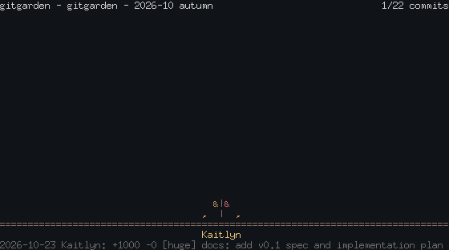

# gitgarden

[](https://github.com/dpologdvinity/gitgarden/actions/workflows/ci.yml)
[](https://github.com/dpologdvinity/gitgarden/releases/latest)
[](go.mod)
[](LICENSE)
[](https://github.com/dpologdvinity/gitgarden/releases/latest)

`gitgarden` plays a git repository's history as an animated ASCII garden. Every contributor is a plant: commits make it grow taller and add leaves, deleted lines drop leaves, and the month of each commit sets the season. Play it in the terminal, print a still final frame, or export a GIF for your README. It is read-only and deterministic: the same repo and flags give the same output.



## Install

### Homebrew

```
brew install dpologdvinity/tap/gitgarden
```

### apt (Debian, Ubuntu)

```
curl -fsSL https://dpologdvinity.github.io/gitgarden/gitgarden.gpg | sudo tee /usr/share/keyrings/gitgarden.gpg > /dev/null
echo "deb [signed-by=/usr/share/keyrings/gitgarden.gpg] https://dpologdvinity.github.io/gitgarden stable main" | sudo tee /etc/apt/sources.list.d/gitgarden.list
sudo apt update && sudo apt install gitgarden
```

Packages are built for amd64 and arm64, and the repository is signed. Later `apt upgrade` runs pick up new releases.

### Go install

```
go install github.com/dpologdvinity/gitgarden@latest
```

Or download a binary from the [releases page](https://github.com/dpologdvinity/gitgarden/releases/latest) (linux, macOS and Windows; amd64 and arm64).

## Usage

```
usage: gitgarden [flags]

Plays a repository's git history as an ASCII garden.

flags:
  -C dir          repository directory (default ".")
  --since date    only plant commits after date (any git date)
  --speed x       playback speed multiplier (default 1)
  --still         print only the final frame
  --gif file      write an animated GIF instead of playing
  --width n       frame width in cells, 40-160 (default: terminal)
  --height n      frame height in cells, 12-60 (default: terminal)
  --no-color      disable color
  --version       print version

keys while playing: q quit
```

`gitgarden` with no flags plays the repo in the current directory. When stdout is not a terminal it prints the still frame instead. Color is off when `NO_COLOR` is set or `--no-color` is given.

Example of `gitgarden --still --width 60 --height 16`:

```
gitgarden - REPO - 2024-12 winter               12/12 commits


                   *Y*      *Y*      *Y*
                   *|*      *|*      *|*
                    |        |        |
                    |        |        |
                    |        |        |
                 ,  |     ,  |     ,  |
============================================================
                   Cy       Bob      Ada
2024-12-15 Cy: +16 -12 change 11
```

## How it works

- Merge commits are skipped, since their changes are already counted in the commits they merge.
- Huge commits (over 1000 added or deleted lines) count once, with lines capped at 1000, and show `[huge]` in the status line.
- Seasons follow the month of the current commit (northern hemisphere): Dec-Feb winter, Mar-May spring, Jun-Aug summer, Sep-Nov autumn.
- Each plant is a trunk with a teardrop crown of leaves, drawn against a sky-blue background.
- Beyond what fits on screen, the remaining contributors become wildflowers.
- Exit codes: 0 success, 1 no commits, 2 usage or git error.

## Architecture in brief

`git log` output is parsed by `internal/gitlog` into commits; `internal/garden` ranks authors, samples
snapshots of their cumulative stats and draws each snapshot into a character grid (`internal/frame`);
the grid is then printed, played in the terminal (`internal/player`) or encoded as a GIF
(`internal/gifenc`). Details and design decisions are in [ARCHITECTURE.md](ARCHITECTURE.md).

## Development

```
go test ./...        # unit and golden tests
go vet ./...
gofmt -l .           # must print nothing
```

Golden files live in `testdata/golden`. After an intended change to the output, regenerate them per package with `go test ./internal/<pkg> -update` and review the diff.

Contributions are welcome: see [CONTRIBUTING.md](CONTRIBUTING.md). [ARCHITECTURE.md](ARCHITECTURE.md) explains how the code is organized, and [docs/SPEC.md](docs/SPEC.md) describes the exact behavior.

## License

MIT, see [LICENSE](LICENSE).
